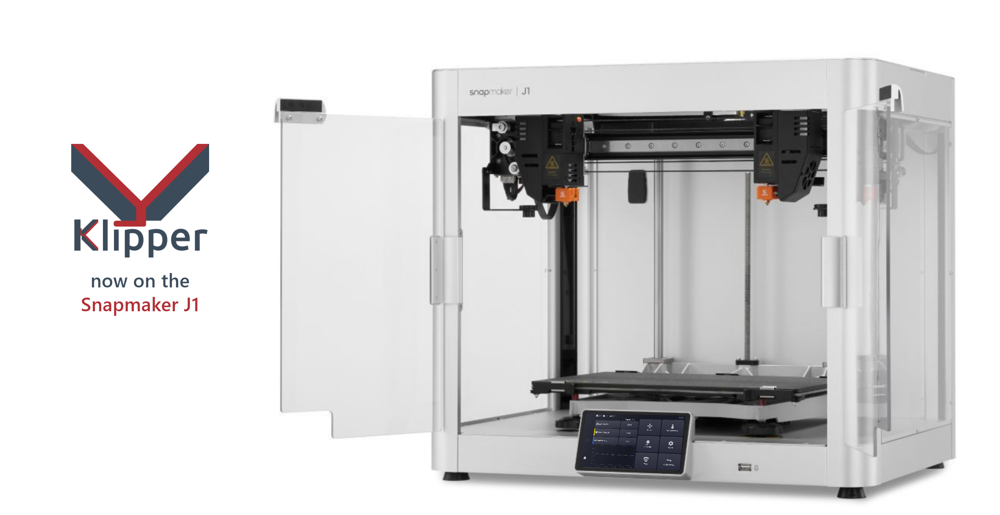
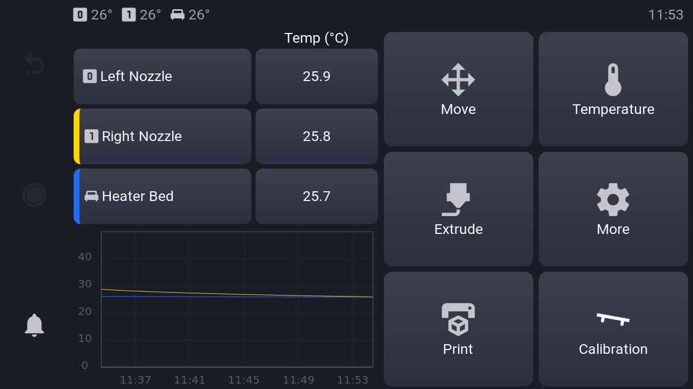
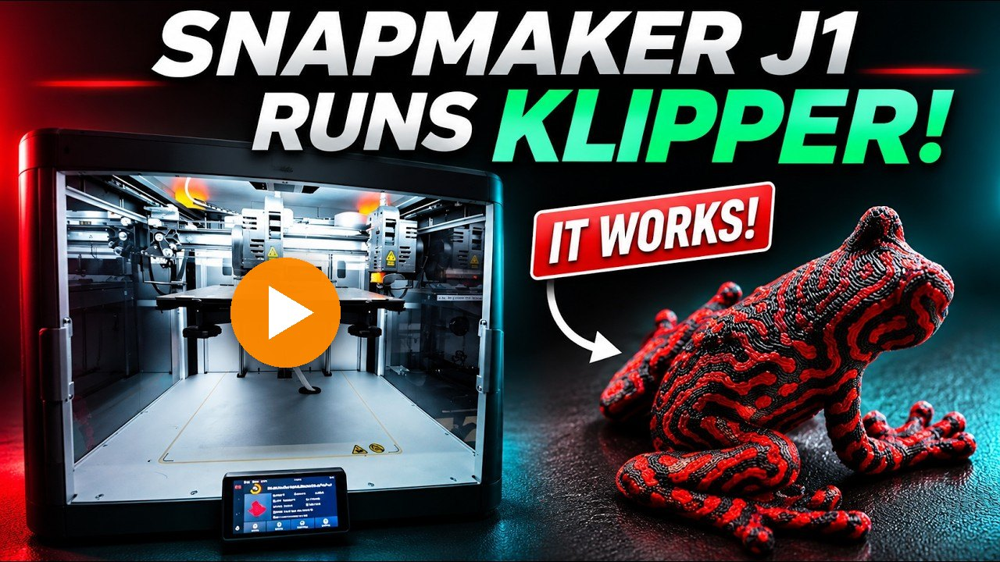
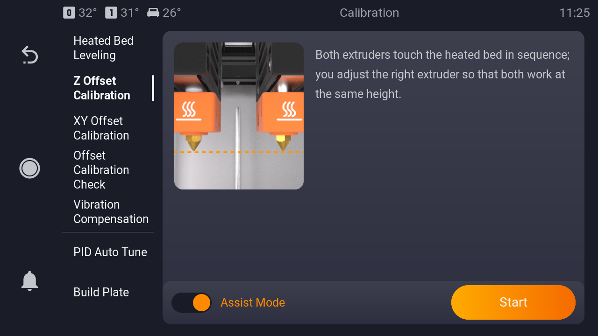
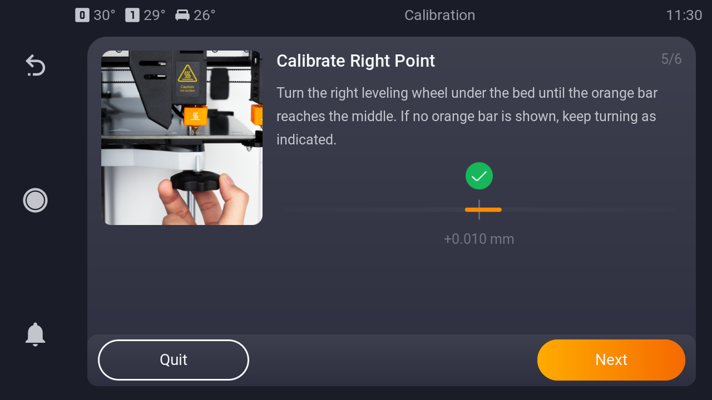
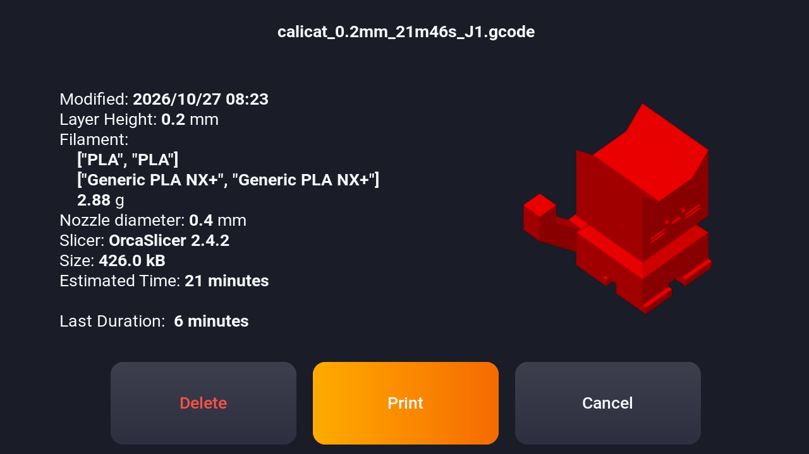
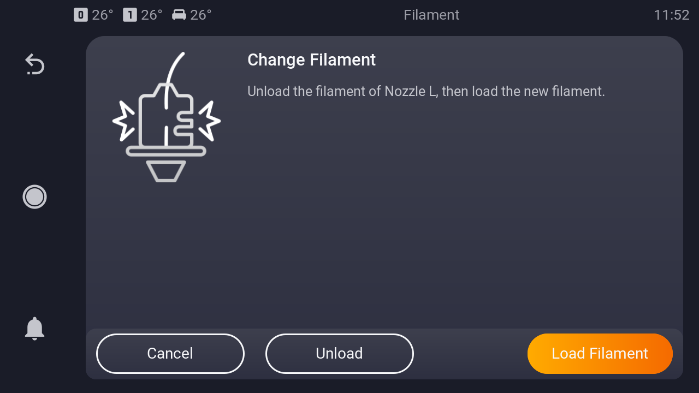
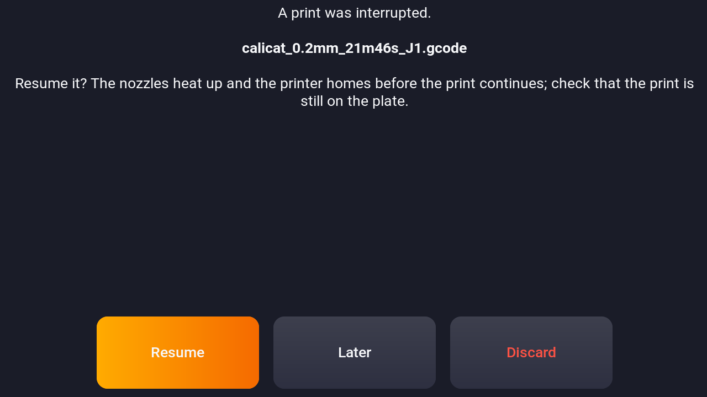
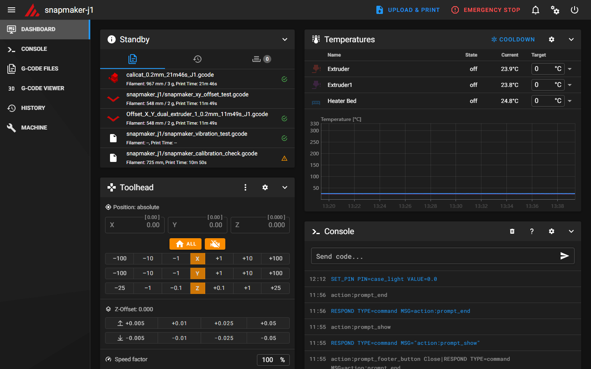

# Klipper for the Snapmaker J1

**Your Snapmaker J1 with Klipper — on its own touch screen, with the J1
calibrations you know.**

KlipperSnapmakerJ1 replaces the stock firmware of the Snapmaker J1 IDEX
printer with [Klipper](https://github.com/Klipper3d/klipper).  The display
of the printer keeps working as its touch screen: it runs Klipper,
Moonraker and KlipperScreen in the look of the stock display, with the
guided calibrations, the pictures and the animations of the J1.  No extra
Raspberry Pi, no extra screen, no wiring.

## Why Klipper on the J1

- **Everything you had, on the screen you know.** Printing, temperature,
  move, extrude, light, fans and the J1 calibrations, in the colors of the
  stock display.
- **All the Klipper features.** Input shaping, pressure advance, macros,
  the console, the configuration in plain text files, and the large
  Klipper community.
- **A web interface.** Mainsail in every browser of your network: watch
  and control prints, upload files, edit the configuration.
- **Your slicer profiles keep working.** Files sliced with the J1
  profiles (for example in OrcaSlicer) print without changes, in every
  IDEX mode.
- **Updates with one tap.** Klipper, Moonraker, KlipperScreen and the J1
  support update from the screen or the browser.
- **The way back stays open.** The stock firmware can be installed again.

## See it in action

A two-color print in IDEX mode on a J1 with Klipper, from the touch
screen to the finished part:

## A closer look

### Guided calibration, as on the stock display

All J1 calibrations are there, with the pictures and animations of the
stock display: heated bed leveling, Z offset, XY offset (assisted with the
calibration probe, or manual with a test print), the offset check,
vibration compensation, PID tuning and the build plate thickness.  The
results are stored at once, without a restart.

<table>
<tr>
<td></td>
<td></td>
</tr>
<tr>
<td>The calibration menu: every workflow with its description</td>
<td>Live height indicator: turn the wheel until the green tick shows</td>
</tr>
</table>

### Two toolheads, all IDEX modes

Full control, duplication, mirror and backup mode, taken from the print
file.  Both nozzles are checked against the file before the print
starts.

<table>
<tr>
<td></td>
<td></td>
</tr>
<tr>
<td>Print files with thumbnail and slicer data</td>
<td>Nozzle check before the print</td>
</tr>
</table>

### Filament and power loss

Filament sensors on both toolheads with the runout and change dialog,
loading and unloading from the screen, and the recovery of a print
interrupted by a power loss.

<table>
<tr>
<td></td>
<td></td>
</tr>
<tr>
<td>Filament runout and change</td>
<td>Resume after a power loss</td>
</tr>
</table>

### In the browser

Mainsail runs on the printer: open `http://snapmaker-j1.local`.  The
dialogs of the printer appear there too, and the slicer uploads and
starts prints directly.

**See every screen in the [user manual](docs/Manual.md).**

## Download

&nbsp;

| File | For |
| --- | --- |
| `KlipperSnapmakerJ1-install.zip` | stock firmware → Klipper: display system and main controller firmware |
| `J1-Stock-Firmware.zip` | Klipper → stock firmware |

## Installation

Both ways run from a USB stick (FAT32, 2 GB or more) on the touch
screen, without tools and without opening the printer.  Unpack the zip
file and copy **its contents** to the top level of the stick.

### Stock firmware → Klipper

The installation package holds an update package for the Snapmaker
system (`J1_V*.bin`: the stock main controller firmware and the
installer) and the Klipper system in the folder `install`.

> [!CAUTION]
> **This takes a while: about 7 minutes.  Do not pull the USB
> stick and do not switch the printer off until the Klipper main menu
> appears.**  The printer restarts by itself on the way and the screen
> stays dark for a while; that is normal.  A stick pulled in the middle can
> leave the printer unable to start.

1. **Copy** the contents of the installation package to a USB stick
   (FAT32): `J1_V*.bin` and the folder `install`.
2. **Insert the stick** into the USB port on the front of the J1 and
   start the firmware update from the USB stick on the Snapmaker touch
   screen; confirm it.
3. **Wait**, leave the stick plugged in and do not switch the printer
   off.  The printer runs through these screens by itself:
   - the Snapmaker update up to 99 %;
   - **Klipper installation** for a moment, a white screen, then the
     screen goes dark for up to a minute while the boot partitions are
     written;
   - the Snapmaker logo, then white text: the maintenance system checks
     the files on the stick and writes the Klipper system (a few
     minutes);
   - the first start of Klipper installs the Klipper firmware on the
     main controller (about a minute), then the Klipper main menu
     appears.
4. **Connect to your network** under **More → Network → WLAN**
   (required).  The clock, the updates and the web interface need it;
   the printer is then reachable at `http://snapmaker-j1.local`.
5. **Calibrate** in the **Calibration** menu before the first print
   (required), in the order of the
   [user manual](docs/Manual.md#first-start-connect-the-wlan-and-calibrate):
   bed leveling, Z offset, XY offset, offset check.  Without it the
   nozzle height and the offset between the nozzles are not right.

If the screen **Klipper installation** reports a failure, or stays
without restarting the printer, tap **Back to Snapmaker**: the Snapmaker
app returns.  Until the printer restarts, nothing of the Snapmaker system
has been changed.

> [!WARNING]
> **Calibrate the printer right after the installation, before the first
> print.**  Klipper starts with the values of an uncalibrated J1: the
> nozzle height above the bed and the offset between the two nozzles are
> not right, the first layer fails and a nozzle can crash into the bed.
> In the **Calibration** menu run the assisted workflows in this order:
> **Heated Bed Leveling, Z Offset Calibration, XY Offset Calibration,
> Offset Calibration Check**, then **Vibration Compensation** once.

### Klipper → stock firmware

The stock firmware package holds the official Snapmaker update package
(`J1_V*.bin`) and the Snapmaker system of the display module in the
folder `stock-restore`.

> [!CAUTION]
> **This takes a while: about 3 minutes.  Do not pull the USB
> stick and do not switch the printer off until the Snapmaker setup
> appears.**  The printer restarts by itself on the way; that is normal.
> A stick pulled in the middle can leave the printer unable to start.

1. **Copy** the contents of the stock firmware package to a USB stick
   (FAT32) and insert it into the USB port on the front of the J1.
2. On the touch screen open **More → System**, scroll to the end and tap
   **Stock Firmware**.  The page shows the package and the Snapmaker
   system it found on the stick.
3. Tap **Restore Stock Firmware** and confirm (not possible while
   printing).  Leave the stick plugged in and do not switch the printer
   off:
   - the main controller gets the Snapmaker firmware (1 to 3 minutes);
   - the printer restarts into the maintenance system, which checks the
     files and writes the Snapmaker system (a few minutes);
   - the printer starts the Snapmaker system.
4. The **Snapmaker setup** starts as on a new printer: language, WLAN
   and the calibrations.  Finish it before printing.

Klipper, its settings, the calibrations and the files on the printer are
deleted; the way to Klipper stays open with the installation package.
See the [user manual](docs/Manual.md#back-to-the-stock-firmware) for the
screens.

## Status

**Version 1.2.0** ([changelog](CHANGELOG.md)).  Runs on the J1 (board revision 2), with Klipper, Moonraker and
KlipperScreen on the display module: printing, the calibration menu and
the filament handling on the touch screen, and Mainsail in the browser.
The open items are listed in the
[technical documentation](docs/Snapmaker_J1.md#open-items).

## Documentation

| Document | Content |
| --- | --- |
| [User manual](docs/Manual.md) | every screen and menu, the calibration workflows step by step, the web interface |
| [Technical manual](docs/Technical.md) | components, installing on your own Klipper host, firmware build, updates, compatibility |
| [Snapmaker_J1.md](docs/Snapmaker_J1.md) | hardware, how each stock function is implemented in Klipper, open items |
| [KlipperSnapmakerJ1-os](https://github.com/Nimrasol/KlipperSnapmakerJ1-os) | the Linux system of the display module, which runs Klipper, Moonraker, KlipperScreen and Mainsail on the printer |
| [Nimrasol/klipper](https://github.com/Nimrasol/klipper/tree/j1), branch `j1` | the main controller support (GD32F305, J1 factory bootloader) as Klipper commits, for reference and review |

## Special thanks

To **eazrael** ([wiki.evilazrael.de](https://wiki.evilazrael.de/)), who
brought Linux to the display module of the J1: his lk2nd port, the device
tree and the kernel configuration of the display are the base of the
display system, and his
[write-up](https://wiki.evilazrael.de/snapmaker-j1-klipper-installation)
showed that Klipper on the J1 can work.

## Support

If KlipperSnapmakerJ1 is useful to you, you can
[buy me a coffee](https://buymeacoffee.com/3pjgRWxRFB).

## License

GNU GPLv3, see [LICENSE](LICENSE), like Klipper and KlipperScreen.
